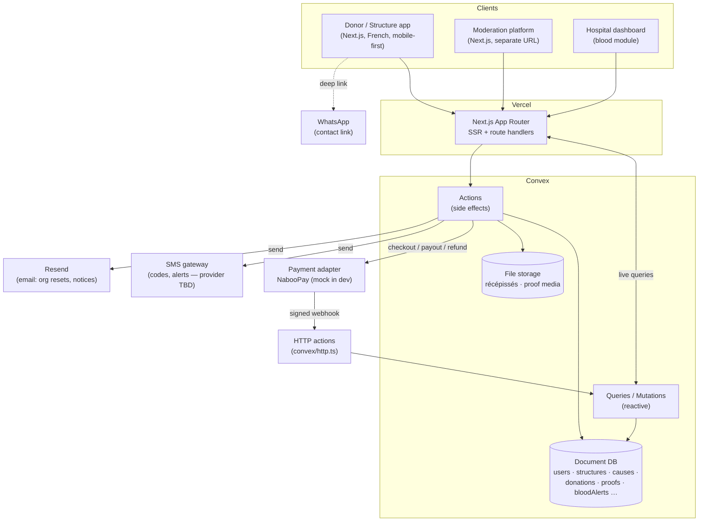

# SUNUSOCIAL — Architecture

| | |
|---|---|
| **Version** | 1.0 |
| **Last Updated** | 29 October 2026 |

---

## 1. Overview

SUNUSOCIAL is a **Next.js (App Router) application backed by Convex**, deployed on Vercel. The design is a reactive monolith rather than a service mesh: Convex holds the data and the server logic (queries, mutations, actions), and Next.js renders both the public/donor/structure app and — under a separate route group and public URL — the moderation platform. The choice of Convex is deliberate: its **live queries drive the realtime surfaces** the product needs (donation progress bars that move as others give, blood-alert responses appearing for hospitals, moderation queues updating as items arrive) without a separate websocket layer.

Payments are the one external, side-effectful dependency. The board chose **NabooPay** (API v2). Every donation is credited to **SUNUSOCIAL's NabooPay merchant account**; the app's ledger holds it against its cause until the goal or deadline, then a **payout** sends the structure's share in one lump sum to its verified mobile-money account. Refunds are payouts of the net amount back to the donor. NabooPay sits behind a **provider adapter** with a `mock` twin for development and tests, so no feature code calls NabooPay directly. Decisions referenced below as `DB-*` / `DT-*` are in `DECISIONS.md`.

## 2. System Diagram

## 3. Components

### 3.1 Frontend — Donor / Structure app
- **Purpose:** the public-facing product: landing, auth, donor browsing/donating/dashboard, structure dashboard and cause/proof management, hospital dashboard, blood module.
- **Key routes/pages:** `/` (landing), `/connexion` & `/inscription` (auth), `/causes` (feed), `/causes/[id]` (detail + donation modal), `/profil` (donor dashboard), `/sang` (blood), `/structure/*` (org dashboard, create cause, proof), `/hopital/*` (stock, alerts).
- **Framework:** Next.js App Router + React 19 + TypeScript (strict); Tailwind CSS + shadcn/ui themed with the charte (DT-10); Convex React client for live data; Convex Auth for sessions (DT-1).
- **Key responsibilities:** render French, mobile-first UI; drive the donation modal with live fee/net math; reflect realtime progress; guard routes by session role.

### 3.2 Moderation platform
- **Purpose:** the separate trust-and-safety surface.
- **Key routes/pages:** `/moderation` (login), `/moderation/file` (queues), and review screens for structures, causes, proofs, deletion requests, refund requests.
- **Framework:** same Next.js app, `app/moderation` route group served on its own subdomain (`moderation.<domain>`). `middleware.ts` routes by host: the moderation host serves only this group, the main host 404s `/moderation/*` (DT-9). Email + password + SMS code; no role selector; sessions ≤ 7 days.
- **Key responsibilities:** show each item exactly as donors will see it; enforce mandatory refusal reasons; verify structure documents **and payout accounts**; arbitrate deletions (fund fate) and refunds; pick the weekly "Coup de cœur"; decide extension requests (cause deadlines, proof delays); track proof deadlines and suspensions; oversee (close/disable) blood alerts; watch the payout queue and NabooPay balance; every decision is audit-logged.

### 3.3 Backend & Database — Convex
- **Purpose:** the single source of data and server logic.
- **Framework:** Convex — schema + queries (reactive reads), mutations (transactional writes), actions (external side effects: payments, SMS, file ops).
- **Key responsibilities:** enforce authorization and input validation at every function; keep money as integer FCFA; compute cause status transitions; expose live queries for progress/queues/alerts; store récépissés and proof media in Convex file storage.

### 3.4 Payment provider adapter
- **Purpose:** isolate NabooPay API v2 behind one interface (`createCheckout`, `verifyWebhook`, `getTransaction`, `cancelTransaction`, `payout`, `getPayout`, `listPayouts`, `getBalance`).
- **Framework:** Convex actions + a provider module selected by `PAYMENT_PROVIDER` (`naboopay` | `mock`; `mock` refused in production). Separate API keys: `checkout` scope for transactions, `payout` scope for payouts. The webhook is a Convex `httpAction` at `POST /payments/naboopay/webhook` (DT-3).
- **Key responsibilities:** create checkouts (`fees_customer_side: false`); verify `X-Signature` HMAC on the raw body and record payments idempotently on `order_id`; re-check pending transactions (success page + cron) because webhooks are success-only and can be dropped; hold funds in the app ledger; run **all payouts through one single-flight worker** (NabooPay allows one payout at a time, has no idempotency key, and reviews > 2,000,000 XOF manually); reconcile the ledger with the NabooPay balance daily.

### 3.6 SMS & notifications
- **Purpose:** one `otp` module (donor signup verification, org/hospital/moderator 2FA, donor password reset) and `notify.send` (in-app + SMS + email).
- **Framework:** SMS adapter selected by `SMS_PROVIDER` (`console` in dev/preview; real provider pending the board).
- **Key responsibilities:** hashed, expiring, attempt-limited codes; rate limits per number; batched fan-out for blood alerts.

### 3.5 Blood module (within the app + Convex)
- **Purpose:** hospital alerts and donor responses.
- **Key responsibilities:** match alerts to opted-in donors by blood type and commune; record visit-slot responses; maintain per-group stock; send thank-you messages; never expose donor addresses.

## 4. Key Data Flows

### 1. Donor registration & login
Donor submits name + phone + password → `otp.send(donor_signup)` texts a 6-digit code → donor enters it → `auth.registerDonor` creates the user with `phoneVerifiedAt` (signup logged) → Convex Auth session (7 days) → donor lands on the causes feed. Later logins are phone + password (logged), with no code at login.

### 2. Browse → donate (core loop)
Donor opens `/causes` → live query streams approved causes → opens a cause → clicks "Faire un don" → modal computes the estimated fee + net live (3%, DT-6) → confirm triggers a Convex action → `POST /transactions` returns `order_id` + `checkout_url`; the `order_id` is stored → donor pays with Orange Money/Wave on NabooPay's page → NabooPay calls the signed webhook (`httpAction`) — or the success page / cron finds the transaction `paid` → internal mutation records the donation as **held** with NabooPay's actual fee, increments `raised` (gross) and, on a first gift, `donorCount` → the progress bar updates in realtime for everyone viewing. If `raised ≥ goal`, release is scheduled immediately.

### 3. Fund release
- **Every cause has a deadline** (DB-5), at most **30 days** after publication; a structure can request an extension, applied only after moderator approval (DB-11).
- **Goal reached:** the payment mutation schedules `payments.releaseCause` at once; the cause closes and stops accepting donations.
- **Deadline reached:** an hourly cron releases everything collected, even at 1% of goal.
- Release is automatic (no moderator action): **one lump-sum payout** (DB-4) of Σ net, queued in the single payout worker, to the structure's verified OM/Wave account; idempotent via `fundsReleasedAt`; blocked while a payout-account change awaits review.
- Each release opens a **7-day proof deadline** (DB-12); the structure may request a delay, which a moderator approves; a missed deadline auto-suspends the structure.

### 4. Organization: create cause → moderation → active
Structure submits a cause (banner, title, description, category, end condition, target, urgency) → status `Soumise` → `En modération` → moderator approves (`Active`) or refuses (with a reason shown to the structure). A cause still in moderation (no donations) can be withdrawn by the structure itself.

### 5. Proof of reception
After funds arrive, the structure uploads ≥ 5 items + report + fund breakdown → a `"use node"` action auto-flags suspicious items (duplicate-image hash, EXIF date, reused invoice ref, spend vs. received — DT-13) → moderator reviews the exact donor-facing dossier → on validation it appears in donor dashboards and the public proofs feed. A deleted cause whose funds went to the structure owes a proof within 7 days; missing it auto-suspends the account.

### 6. Deletion of a published cause
Structure sends a motivated deletion request → moderator arbitrates: refund donors (funds are still held) **or** pay out to the structure. The decision carries a reason shown to structure and donors; a payout triggers a 7-day proof deadline.

### 7. Refund request
While funds are held, a donor requests a refund from their dashboard with a reason → moderator decides (final) → if accepted, the payout worker sends the **net amount** to the donor's verified phone on the method they paid with (NabooPay's own refund endpoint is full-amount only, so it isn't used).

### 8. Blood alert
The hospital creates an alert (moderators can close or disable any alert) (blood types, units, urgency, target communes in the hospital's region) → preview shows "X donneurs compatibles seront notifiés" → sent in-app + SMS to compatible opted-in donors in those communes → donors confirm a visit slot → hospital confirms attendees (stock +1 each) → on close, hospital sends a thank-you message.

## 5. External Services

| Service | Purpose | Notes / Cost |
|---------|---------|--------------|
| Vercel (Pro) | Hosting, SSR, preview deploys | Part of ~45,000 FCFA/month infra, paid by client |
| Convex (Pro) | Database, server functions, realtime, file storage | Part of ~45,000 FCFA/month infra, paid by client |
| **NabooPay** (API v2) | Checkout (Orange Money, Wave), payouts (releases + refunds), balance | 3% per donation (DB-1). Unverified org capped at 200,000 XOF/month → KYB required. 100 req/60 s per endpoint |
| Resend | Email: org password resets, notifications | Free tier likely sufficient at launch |
| SMS gateway | Codes (signup, 2FA, reset), blood alerts, key notifications | **Required; provider, budget, sender ID pending** — `BOARD_QUESTIONS.md` Q1 |
| WhatsApp | Contact fallback (in-kind, questions) | Deep link to SUNUSOCIAL's number; no API integration |
| Unsplash | Placeholder imagery in the prototype only | Not used in production |

## 6. Scalability Notes

- **Current constraints are deliberately small:** a Senegal-market MVP on Convex Pro and Vercel Pro. Convex's reactive queries handle the expected concurrency (hundreds of simultaneous viewers on a hot cause) without extra infrastructure.
- **Realtime cost** grows with viewers-per-cause; if a single cause goes viral, debounce progress updates on the client and keep the live query payload lean (ids + aggregates, not full documents).
- **Payments are the throughput ceiling**, bounded by the provider's rate limits; checkout and webhook handling run in Convex actions and should be idempotent (dedupe on provider transaction id) so retries never double-count a donation.
- **File storage** (récépissés, proof media) is the main storage growth; enforce the upload limits (images/PDF ≤ 5 MB, video ≤ 50 MB / 90 s — DT-12) and resize images client-side.
- **Path to scale:** the architecture already isolates the two heaviest concerns (payments behind an adapter, media in file storage). The natural Phase 2 step is native mobile apps consuming the same Convex backend — no backend re-architecture required.
