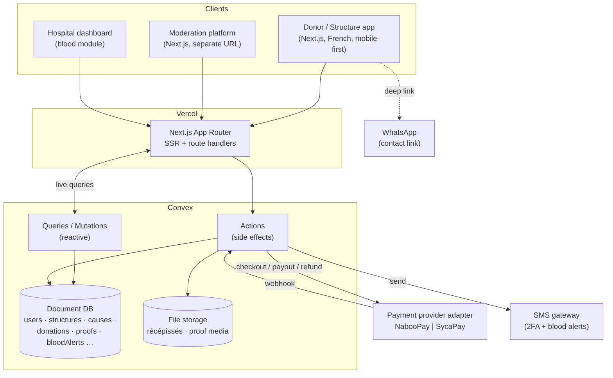

# SUNUSOCIAL — Architecture

| | |
|---|---|
| **Version** | 1.0 |
| **Last Updated** | 28 October 2026 |

---

## 1. Overview

SUNUSOCIAL is a **Next.js (App Router) application backed by Convex**, deployed on Vercel. The design is a reactive monolith rather than a service mesh: Convex holds the data and the server logic (queries, mutations, actions), and Next.js renders both the public/donor/structure app and — under a separate route group and public URL — the moderation platform. The choice of Convex is deliberate: its **live queries drive the realtime surfaces** the product needs (donation progress bars that move as others give, blood-alert responses appearing for hospitals, moderation queues updating as items arrive) without a separate websocket layer.

Payments are the one external, side-effectful dependency, isolated behind a **provider adapter** so the board's pending NabooPay-vs-SycaPay decision changes one module, not the app. The two providers differ in a way that matters architecturally: **NabooPay holds funds (escrow) until a cause's goal or deadline is met; SycaPay pays each donation straight to the structure.** The whole fund-control, refund, and deletion-arbitration logic branches on this, so the provider is modeled as a first-class setting, not a hidden detail.

## 2. System Diagram

## 3. Components

### 3.1 Frontend — Donor / Structure app
- **Purpose:** the public-facing product: landing, auth, donor browsing/donating/dashboard, structure dashboard and cause/proof management, hospital dashboard, blood module.
- **Key routes/pages:** `/` (landing), `/connexion` & `/inscription` (auth), `/causes` (feed), `/causes/[id]` (detail + donation modal), `/profil` (donor dashboard), `/sang` (blood), `/structure/*` (org dashboard, create cause, proof), `/hopital/*` (stock, alerts).
- **Framework:** Next.js App Router + React + TypeScript; Convex React client for live data.
- **Key responsibilities:** render French, mobile-first UI; drive the donation modal with live fee/net math; reflect realtime progress; guard routes by session role.

### 3.2 Moderation platform
- **Purpose:** the separate trust-and-safety surface.
- **Key routes/pages:** `/moderation` (login), `/moderation/file` (queues), and review screens for structures, causes, proofs, deletion requests, refund requests.
- **Framework:** same Next.js app, isolated route group with its own layout and its own public URL; email + password + SMS 2FA; no role selector.
- **Key responsibilities:** show each item exactly as donors will see it; enforce mandatory refusal reasons; arbitrate deletions (fund fate) and refunds; track proof deadlines and suspensions; (prototype) create blood alerts.

### 3.3 Backend & Database — Convex
- **Purpose:** the single source of data and server logic.
- **Framework:** Convex — schema + queries (reactive reads), mutations (transactional writes), actions (external side effects: payments, SMS, file ops).
- **Key responsibilities:** enforce authorization and input validation at every function; keep money as integer FCFA; compute cause status transitions; expose live queries for progress/queues/alerts; store récépissés and proof media in Convex file storage.

### 3.4 Payment provider adapter
- **Purpose:** isolate NabooPay/SycaPay behind one interface (`createCheckout`, `handleWebhook`, `releaseFunds`, `refund`).
- **Framework:** Convex actions + a provider module selected by `PAYMENT_PROVIDER`.
- **Key responsibilities:** initiate mobile-money checkout; verify and process webhooks; under NabooPay, hold then release at goal/deadline and support refunds; under SycaPay, treat each donation as immediately paid out (no escrow, no refund).

### 3.5 Blood module (within the app + Convex)
- **Purpose:** hospital alerts and donor responses.
- **Key responsibilities:** match alerts to opted-in donors by blood type and commune; record visit-slot responses; maintain per-group stock; send thank-you messages; never expose donor addresses.

## 4. Key Data Flows

### 1. Donor registration & login
Donor submits name + phone + password → Convex `auth.registerDonor` mutation creates the user (password hashed) → session established → donor lands on the causes feed. Login is phone + password, **no OTP**.

### 2. Browse → donate (core loop)
Donor opens `/causes` → live query streams approved causes → opens a cause → clicks "Faire un don" → modal computes fee + net live from the active provider's rate → confirm triggers a Convex action → provider adapter opens Orange Money/Wave checkout → provider webhook confirms payment → mutation records the donation, increments the cause's `raised`, and (NabooPay) marks funds **held** → the cause's progress bar updates in realtime for everyone viewing.

### 3. Fund release
- **Time-limited cause:** at the deadline, **everything collected is released to the structure automatically**, even at 1% of goal. Release is automatic — no moderator action.
- **Monetary-goal cause:** releases at the goal **or** the deadline, whichever comes first (every cause carries a deadline so funds are never held forever). [HYPOTHESIS — board validation pending]
- Under **SycaPay** there is no hold: each donation is already with the structure, so "release" is a no-op.

### 4. Organization: create cause → moderation → active
Structure submits a cause (banner, title, description, category, end condition, target, urgency) → status `Soumise` → `En modération` → moderator approves (`Active`) or refuses (with a reason shown to the structure). A cause still in moderation (no donations) can be withdrawn by the structure itself.

### 5. Proof of reception
After funds arrive, the structure uploads ≥ 5 items + report + fund breakdown → suspicious items auto-flagged → moderator reviews the exact donor-facing dossier → on validation it appears in donor dashboards and the public proofs feed. A deleted cause whose funds went to the structure owes a proof within 7 days; missing it auto-suspends the account.

### 6. Deletion of a published cause
Structure sends a motivated deletion request → moderator arbitrates: refund donors (NabooPay, funds still held) **or** pay out to the structure; refund is disabled under SycaPay (already paid). The decision carries a reason shown to structure and donors; a payout triggers a 7-day proof deadline.

### 7. Refund request (NabooPay only)
While funds are held, a donor requests a refund from their dashboard with a reason → moderator decides (final) → if accepted, the provider refunds the donor's mobile money. Hidden entirely under SycaPay.

### 8. Blood alert
(Prototype) moderator — or hospital — creates an alert (blood types, units, urgency, target communes in the hospital's region) → preview shows "X donneurs compatibles seront notifiés" → sent in-app + SMS to compatible opted-in donors in those communes → donors confirm a visit slot → hospital confirms attendees (stock +1 each) → on close, hospital sends a thank-you message.

## 5. External Services

| Service | Purpose | Notes / Cost |
|---------|---------|--------------|
| Vercel (Pro) | Hosting, SSR, preview deploys | Part of ~45,000 FCFA/month infra, paid by client |
| Convex (Pro) | Database, server functions, realtime, file storage | Part of ~45,000 FCFA/month infra, paid by client |
| **NabooPay _or_ SycaPay** | Mobile-money payments (Orange Money, Wave) | **[OPEN]** NabooPay 3% + escrow; SycaPay 1.5%, no escrow. One adapter, selected by env var. |
| SMS gateway | 2FA codes + blood alerts | **[OPEN]** provider, cost, and dedicated sender number pending board validation |
| WhatsApp | Contact fallback (in-kind, questions) | Deep link to SUNUSOCIAL's number; no API integration |
| Unsplash | Placeholder imagery in the prototype only | Not used in production |

## 6. Scalability Notes

- **Current constraints are deliberately small:** a Senegal-market MVP on Convex Pro and Vercel Pro. Convex's reactive queries handle the expected concurrency (hundreds of simultaneous viewers on a hot cause) without extra infrastructure.
- **Realtime cost** grows with viewers-per-cause; if a single cause goes viral, debounce progress updates on the client and keep the live query payload lean (ids + aggregates, not full documents).
- **Payments are the throughput ceiling**, bounded by the provider's rate limits; checkout and webhook handling run in Convex actions and should be idempotent (dedupe on provider transaction id) so retries never double-count a donation.
- **File storage** (récépissés, proof media) is the main storage growth; enforce the 5 MB upload cap and prefer compressed media.
- **Path to scale:** the architecture already isolates the two heaviest concerns (payments behind an adapter, media in file storage). The natural Phase 2 step is native mobile apps consuming the same Convex backend — no backend re-architecture required.
